<div align="center">

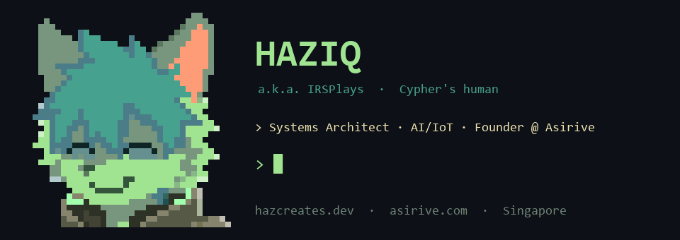

<br/>

**Systems Architect · AI/IoT Engineer · Founder of [Asirive](https://www.asirive.com/)**
*Singapore · "Failing with Honour."*

[](https://hazcreates.dev/)
[](https://www.asirive.com/)
[](https://github.com/IRSPlays)
[](https://hackerone.com/irsplays)

</div>

---

<table>
<tr>
<td width="200" align="center" valign="top">
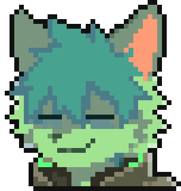<br/>
<sub><b>Cypher</b><br/>mascot, co-engineer,<br/>resident fox</sub>
</td>
<td valign="top">

### About me

I'm **Haziq**. I bridge high-level multimodal AI with low-level edge hardware. I build accessible, high-performance systems: assistive wearables, an in-house edge language model, a decentralized triage engine, on-device vision apps, and competition infrastructure.

I document failures openly, including a "renovation graveyard" of post-mortems on designs that didn't work. Bugs are necessary renovations for character.

I won the **TKKYIA 2026 Merit Award** with a team of three from Admiralty Secondary, where I led the systems side.

</td>
</tr>
</table>

---

## Asirive: ambient intelligence and hardware

I founded [**Asirive**](https://www.asirive.com/) to build *ambient software and assistive hardware*. Two products are the core of it, and [the team page](https://www.asirive.com/team) lists the people behind it.

### Asirive Cortex

[**Cortex**](https://www.asirive.com/cortex) is spoken navigation for blind and partially sighted cane users, co-designed with the **Singapore Association for the Visually Handicapped (SAVH)**. It is built around one idea: the white cane already handles the ground, so Cortex stays quiet about that and only speaks up about what a cane can't catch.

<div align="center">
<table>
<tr>
<td align="center" valign="middle">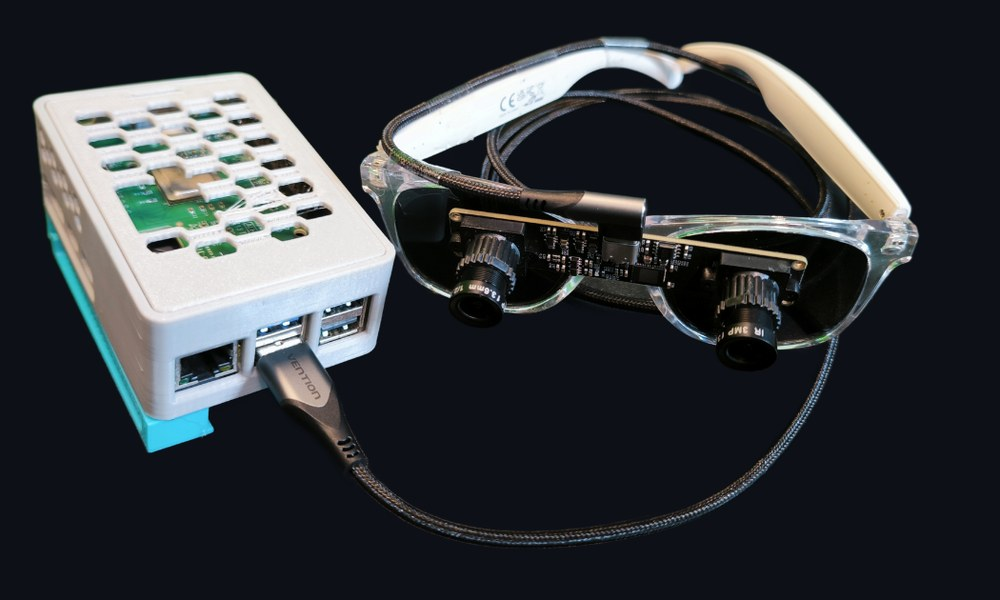<br/><sub><b>Cortex V3</b>: dual-camera glasses and the Raspberry Pi 5 pocket unit, joined by a single USB-C cable</sub></td>
<td align="center" valign="middle">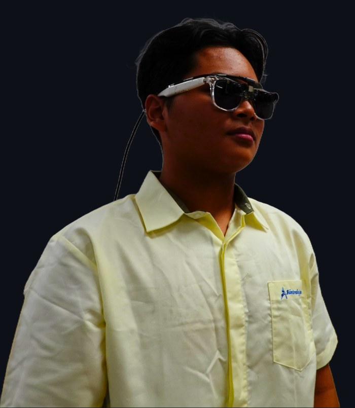<br/><sub><b>Worn</b>: a lighter, open-ear build</sub></td>
</tr>
<tr>
<td colspan="2" align="center">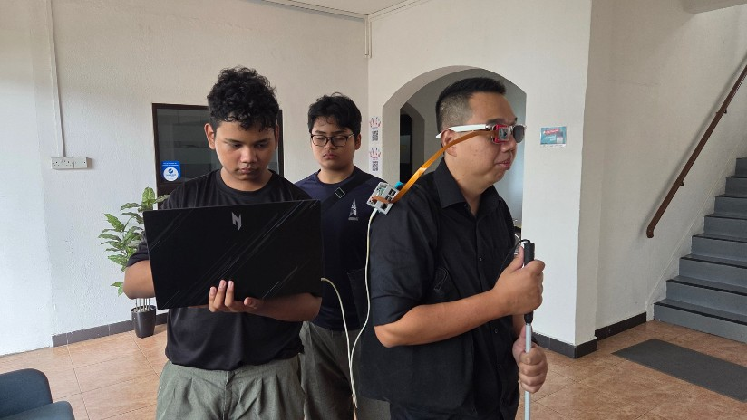<br/><sub><b>Field testing</b> with an SAVH participant, white cane in hand</sub></td>
</tr>
</table>
</div>

**How it evolved, one round of user feedback at a time**

| Version | Build | What we learned |
| :-- | :-- | :-- |
| **V1** | ESP32-CAM streaming frames to a laptop | Slow, but it proved the concept |
| **V2** | Raspberry Pi Compute Module 5 with an AI accelerator, on-device models | The shoulder strap was uncomfortable |
| **V3** | Raspberry Pi 5 + **Hailo-8L**, glasses-mounted dual camera, pocket unit on one USB-C cable | The build that won the **TKKYIA 2026 Merit Award** |
| **V4** *(in progress)* | Refactored software, local navigation on my own model, a companion app, rebuilt glasses | |

**Design decisions that matter**

- **Cane-aware safety:** it only warns about overhead hazards and fast-moving objects, never ground clutter the cane already finds
- **Reflexes stay local:** hazard detection (YOLO on the Hailo accelerator) runs on-device in under 100 ms, with no network
- **Two voices:** conversation and critical safety warnings use different TTS voices, switchable within 100 ms, so you can tell them apart by ear
- **The cloud only when it helps:** Gemini Live for conversation, plus routing and bus arrival times, with memory synced in the background
- **Tested with the people who use it:** a year of SAVH field sessions (2025 to 2026)

[Repo](https://github.com/Asirive/Asirive-Cortex) · [Product page](https://www.asirive.com/cortex)

### Asirive Aether

[**Aether**](https://www.asirive.com/aether) is an in-house edge LLM (REV 0.1, in development, formerly SNAP-C1), trained from scratch on a single consumer GPU.

- About **187M parameters** with a custom architecture mixing **PolyMamba2** (state-space) and **CC-FSA** (frequency attention), plus Mixture-of-Depths routing
- Trained and run on **one AMD RX 7600 (8 GB)** using ROCm/HIP on Windows 11
- About 26.30 BF16 TFLOPS sustained, roughly 3,900 to 4,200 training tokens per second
- 6.55B-token training target, 116 passing tests

[Repo](https://github.com/Asirive/Aether) · [Product page](https://www.asirive.com/aether)

---

## Cyph and VectorM: a fox with a body

<div align="center">
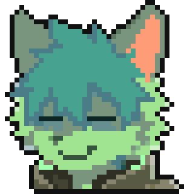

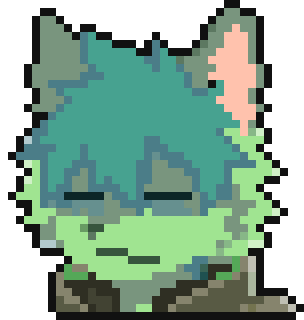
</div>

[**Cyph, the Furry Engineer**](https://github.com/IRSPlays/Cyph) started as a terminal pet for a robot arm and grew into a small system: a personal co-engineer with a body. It lives on my desktop and my phone, plans my day with me, remembers me, talks, and moves a real 6-joint arm ([VectorM](#vectorm-the-arm-firmware), below).

<div align="center">
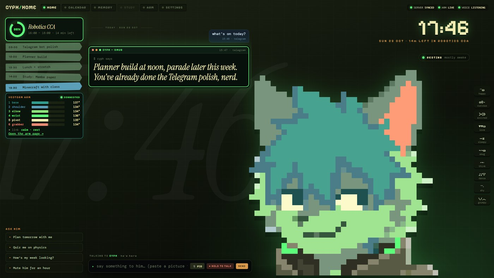
<br/><sub>The desktop app. Screens here are the real UI running on sample data, not my own calendar or chats.</sub>
</div>

<table>
<tr>
<td width="50%" valign="top">

**The system**
- **24/7 server** on a home machine: the brain, planner and memory, over pinned TLS with per-device revocable tokens
- **Desktop and Android apps:** one React UI wrapped with Tauri 2, with Rust owning the network
- **Native Android widgets and notifications** that keep working when the app is closed
- **Telegram bot** for when I'm away from both
- **Local-first brain:** a Qwen model for chat and arm commands, with harder questions routed to Gemini under a daily cap

</td>
<td width="50%" valign="top">

**What he does**
- **Planner:** day, week, month and agenda views, typed quick-add, recurring items, conflict detection
- **Long-term memory:** capped Markdown files, curated in the background and reviewed nightly, with secrets filtered out
- **Voice:** Silero VAD, streaming speech-to-text, TTS, barge-in and a "Hey Cyph" wake word
- **Speaks first, sparingly:** morning brief, heads-ups before things start, quiet hours
- **Moves the arm** by words or by a job: "pick up the red pen" streams the camera to Gemini Robotics-ER and runs its tool calls on the body

</td>
</tr>
</table>

<div align="center">
<table>
<tr>
<td align="center" valign="middle">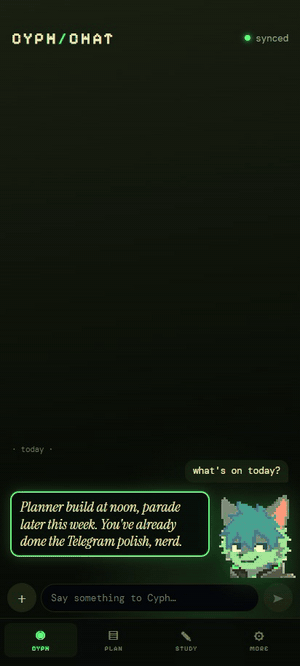<br/><sub>The phone app</sub></td>
<td align="center" valign="middle">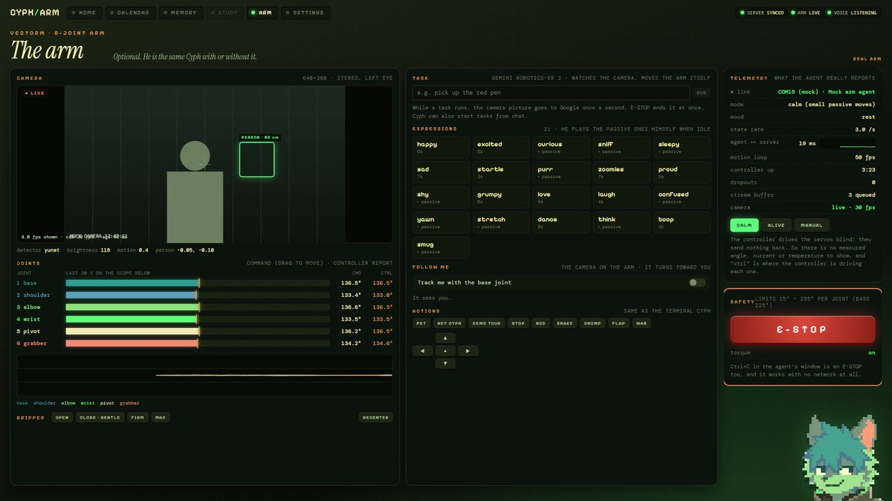<br/><sub>The Arm page (mock camera and arm agent)</sub></td>
</tr>
<tr>
<td align="center" valign="middle">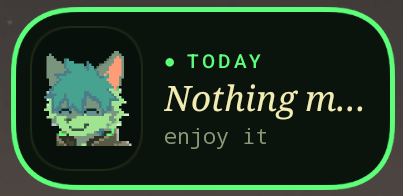<br/><sub>Widget on my real home screen</sub></td>
<td align="center" valign="middle">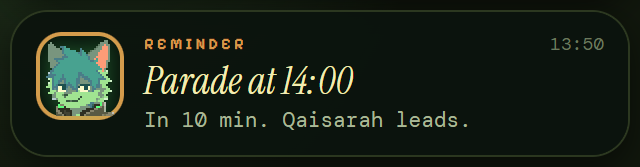<br/><sub>A reminder card, with his face as the avatar</sub></td>
</tr>
</table>
</div>

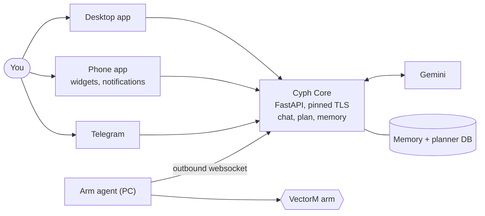

Privacy is a design rule: memory, transcripts and keys stay on my machines, Telegram is owner-only, and widgets never show chat text on the lock screen. Study mode, phone voice, QR pairing and push notifications are not built yet, and the [repo](https://github.com/IRSPlays/Cyph) says so plainly.

<details>
<summary><b>Cypher's mood reel</b></summary>
<br/>
<div align="center">

</div>
</details>

### VectorM: the arm firmware

[**VectorM**](https://github.com/IRSPlays/VectorM) is the body: bare-metal firmware for a 6-DOF robot arm. I replaced the stock firmware on its STM32 controller so the PC can do the thinking (kinematics, planning, vision) while the chip delivers precise, glitch-free servo motion over a CRC-checked serial protocol. It works on its own too: anything that speaks the protocol can move the arm.

| | |
| :-- | :-- |
| **MCU and code** | STM32F103C8T6, plain C with no HAL and no RTOS, **6.7 KB** of flash |
| **PWM** | 2 MHz timer tick, 0.5 us per step, about **0.068 degrees** per step, hardware-timed 50.00 Hz |
| **Motion** | 1 kHz engine, minimum-jerk (smootherstep) profile, so no overshoot or jitter; retargeting mid-move starts from the live position |
| **Glitch-free pulses** | timer-preloaded, so updates latch at the cycle boundary |
| **Protocol** | binary framing, CRC-16/CCITT, sequence numbers, ACK/NAK on every command, 32-point stream queue for waypoint playback |
| **Calibration** | per-servo pulse range, trim and direction, saved to flash |
| **Host tools** | Python `ArmClient`, a serial-bootloader flasher with read-back verify, pin scanning for board bring-up, and **26 animal-like moods** for the arm (what Cyph uses) |

```python
from arm_client import ArmClient

with ArmClient("COM15") as arm:
    arm.move_joints([135, 135, 135, 135, 135, 135], time_ms=1500)
    arm.stream_trajectory(waypoints, dt_ms=20)    # path playback
    arm.torque(False)                             # go limp to pose it by hand
```

[VectorM repo](https://github.com/IRSPlays/VectorM) · [Cyph repo](https://github.com/IRSPlays/Cyph)

---

## More things I've built

| Project | What it is | Stack |
| :-- | :-- | :-- |
| **[Competition Management Platform](https://github.com/IRSPlays/Competition-Management-Platform)** | Infrastructure for **NRPC 2026**: 500+ teams, strict scoring, poster submissions, live leaderboards | `React` `TypeScript` `Node.js` `SQLite` |
| **SWAG Day FCS** | Custom stage AV and broadcast system with **zero audio files**: procedural Web Audio, WebRTC audience cams, controller/stage sync | `Next.js` `TypeScript` `Supabase` |
| **Project Echo** | Decentralized triage with zero identity tracking and automated root-cause analysis | `Next.js` `TypeScript` `Python` |
| **SG60 Heritage Lens** | iOS app that recognizes Singapore landmarks, food and icons through the camera | `SwiftUI` `Core ML` |
| **KopiTalk** | Family board game with an AI game master | `TypeScript` `React` `FastAPI` |
| **WebBlox** | Browser-based Roblox-style game creation and play | `TypeScript` `Three.js` |
| **[Portfolio OS](https://github.com/IRSPlays/Portfolio)** | My site as a mini desktop OS: windows, 3D scene, terminal. [Live](https://hazcreates.dev) | `React` `Vite` `Three.js` |
| **FnafCam** | Five Nights-style horror game | `Next.js` `TypeScript` |
| **Asirive Copartner** *(deprecated)* | An ambient OS-level AI "colleague" built for the Build with Gemini XPRIZE | `Python` `Rust/Tauri` `Gemini` |
| **Fursuit Cortex** *(R&D)* | Early biomechatronics: animatronic tails, jaws and cooling for Cypher's suit | `CAD` `Embedded` |

---

## Tech arsenal

<div align="center">

| | |
| :-- | :-- |
| **AI / ML** |      `MCP` `quantized edge models` |
| **Hardware** |   `Elegoo Neptune 4 Pro` `parametric CAD` `logic analysis` `I2C / SPI / UART` |
| **Firmware and systems** |    `device drivers` |
| **Software** |         `WebRTC` `Web Audio` |
| **Tooling** | `Claude Code` `OpenCode` and other autonomous terminal agents |

</div>

---

## Highlights

- **TKKYIA 2026 Merit Award** (Tan Kah Kee Young Inventors' Award): the highest award in the Student Category that year, shared with a team of three; I led systems
- **A year of SAVH field sessions** (2025 to 2026) co-designing and user-testing Cortex with the people who use it
- **Build with Gemini XPRIZE 2026:** Asirive Copartner entered before the competition retired
- **HackerOne researcher:** [`irsplays`](https://hackerone.com/irsplays)

---

## GitHub stats

<div align="center">


<br/>

</div>

---

## Get in touch

| | |
| :-- | :-- |
| Email | [hello@hazcreates.dev](mailto:hello@hazcreates.dev) |
| Portfolio | [hazcreates.dev](https://hazcreates.dev/) |
| Asirive | [asirive.com](https://www.asirive.com/) · [Cortex](https://www.asirive.com/cortex) · [Aether](https://www.asirive.com/aether) · [Team](https://www.asirive.com/team) |
| GitHub | [@IRSPlays](https://github.com/IRSPlays) · [Asirive org](https://github.com/Asirive) |
| Socials | TikTok [@hazq.aep](https://www.tiktok.com/@hazq.aep) · YouTube [@TheIRSGuy_editz](https://www.youtube.com/@TheIRSGuy_editz) |

<div align="center">
<br/>
<br/>
<i>"I view bugs not as failures, but as necessary renovations for character."</i>
</div>
